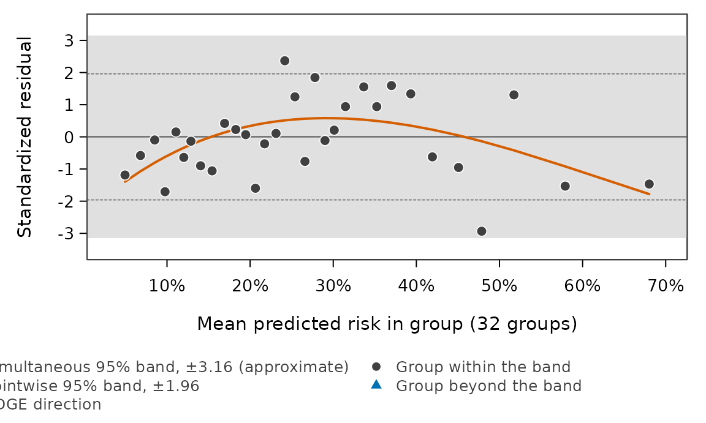
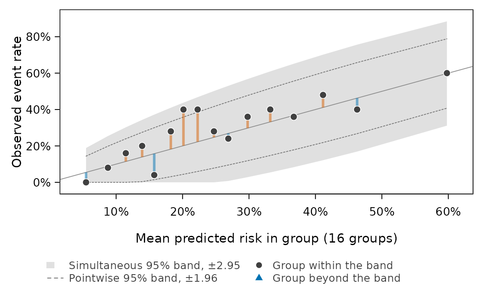
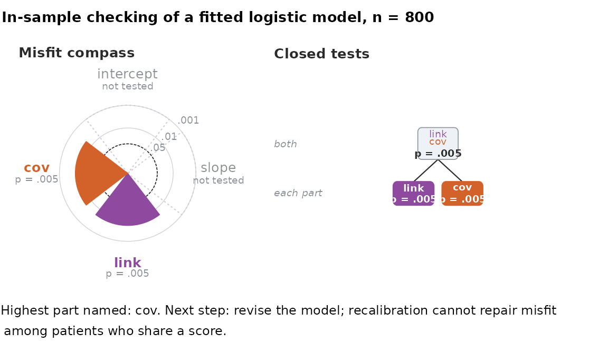
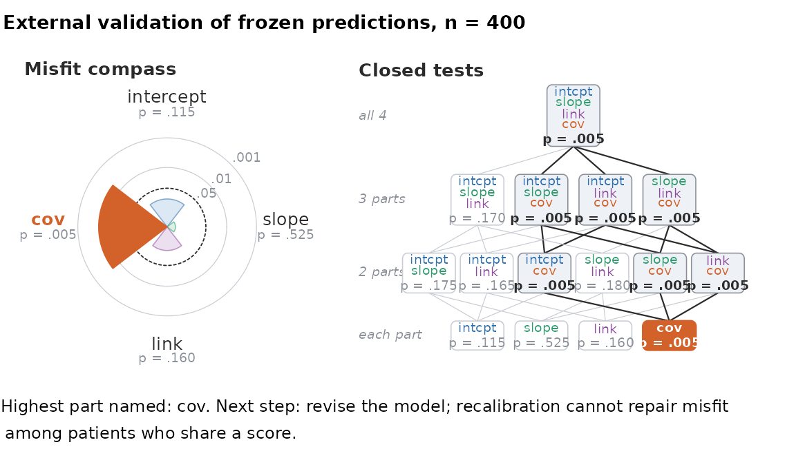

# A goodness-of-fit and calibration toolbox for logistic regression

## Why a toolbox

Before the inferences or predictions of a logistic regression model can
be trusted, its *goodness of fit* has to be checked. Many tests exist
for this, but in practice they are **scattered across different packages
with different interfaces**, base R ships only the Hosmer–Lemeshow idea,
and most of the classical tests **lose power on sparse data** — the
common situation where continuous covariates give almost every
observation its own covariate pattern.

`ebrahim.gof` addresses this in one place. It:

- **introduces the author’s own sparse-data tests** — the omnibus
  Ebrahim–Farrington (EF) test, the *directed* EF / **EDGE** test that
  targets smooth calibration-shape departures, and a Cauchy-combination
  ensemble; and
- **aggregates a wide range of classical and modern tests**
  (Hosmer–Lemeshow, McCullagh, Osius–Rojek, le Cessie–van Houwelingen,
  Stute–Zhu, the binary-adaptive `BAGofT` test, and the `givitiR`
  calibration test) behind **one call**,
  [`run.all.gof()`](https://ebrahimkhaled.github.io/ebrahim.gof/reference/run.all.gof.md),
  so they can be compared head to head. Each aggregated test is obtained
  from its own package and is credited to its authors; they are provided
  for comparison, not claimed as original here.

## The example data

The bundled `gof_demo` dataset was generated from a model whose true
linear predictor is **quadratic in age**. If we fit a model that treats
age *linearly*, it is therefore subtly misspecified through a smooth,
low-dimensional calibration distortion — exactly the misfit a *directed*
test is built to detect and an *omnibus* test tends to miss.

``` r

data("gof_demo", package = "ebrahim.gof")
str(gof_demo)
#> 'data.frame':    800 obs. of  5 variables:
#>  $ outcome  : int  1 0 0 0 0 0 0 0 0 1 ...
#>  $ age      : num  54.9 47.8 27 34.3 47.8 21.3 43.3 63.1 32.6 49 ...
#>  $ bmi      : num  32.3 29.2 22.8 26.2 23.4 19 34.6 33.3 27.6 21.3 ...
#>  $ sex      : int  1 0 1 0 0 1 0 0 1 0 ...
#>  $ treatment: int  0 0 1 0 0 1 1 0 0 0 ...

fit <- glm(outcome ~ age + bmi + sex + treatment,
           data = gof_demo, family = binomial)
```

## One call: the whole battery

[`run.all.gof()`](https://ebrahimkhaled.github.io/ebrahim.gof/reference/run.all.gof.md)
runs the battery and returns a tidy `gof_battery` table. Here we use the
fast subset (`include_slow = FALSE`) and `install = "no"` so nothing is
installed or resampled while the vignette builds; tests whose optional
package is not present are simply skipped.

``` r

set.seed(1)
battery <- run.all.gof(fit, include_slow = FALSE, install = "no")
battery
#> 
#> Goodness-of-fit battery: 25 tests  (18 reject at 0.05)
#> ========================================================
#>  Test                        Statistic   df  p-value    
#>  --- Global --------------------------------------------
#>  Pearson [a]                       760  795   0.8087    
#>  Deviance [a]                    839.1  795   0.1352    
#>  Information-Matrix              26.39    5  7.5e-05 ***
#>  --- Standardized --------------------------------------
#>  Osius-Rojek [b]                -2.388        0.0169 *  
#>  McCullagh [c]                  -2.725        0.9968    
#>  Copas-RSS [b]                   3.352        0.0008 ***
#>  --- Partition -----------------------------------------
#>  HL                              15.52    8   0.0499 *  
#>  HL-largeN [d]                   15.52    8   0.0501 .  
#>  HL-equalwidth                   22.11    7   0.0024 ** 
#>  Pigeon-Heyse                    15.58    9   0.0761 .  
#>  F-test [e]                      2.088    9   0.0283    
#>  EF                              15.95    8   0.0431 *  
#>  EF-normal [f]                   1.767        0.0386 *  
#>  --- Covariate-space -----------------------------------
#>  Tsiatis                         63.53    9  2.8e-10 ***
#>  Xie                              51.9    7  6.1e-09 ***
#>  Pulkstenis-Robinson [g]         7.282    4   0.1217    
#>  --- Directed ------------------------------------------
#>  EDGE [h]                        11.21 2.01   0.0035 ** 
#>  EDGE.G10 [i]                     8.33 2.07   0.0150 *  
#>  DEF.poly2 [i]                   8.299 1.08   0.0036 ** 
#>  DEF.stukel [i]                    6.5 1.56   0.0118 *  
#>  DEF.sym [i]                     1.519    1   0.0096 ** 
#>  Stukel                          11.58    2   0.0031 ** 
#>  --- Calibration ---------------------------------------
#>  Cubic-LR [j]                    12.44    2   0.0020 ** 
#>  --- Ensemble ------------------------------------------
#>  Ensemble.Vote(3DEF) [k]                      0.0070 ** 
#>  Ensemble.Univ(3DEF+EF) [k]                   0.0088 ** 
#> --------------------------------------------------------
#>  Signif.:  *** <.001   ** <.01   * <.05   . <.1
#>  Notes:
#>    [a] sparse form; comparison only, not counted
#>    [b] normal deviate, two-sided
#>    [c] normal deviate, upper tail
#>    [d] H0: eps <= 2.74e-03 (n0 = 1e+06); eps_hat = 9.69e-02
#>    [e] ANOVA F on deviance residuals; comparison only, not counted
#>    [f] normal reference, many groups (G = 32)
#>    [g] split on categorical: sex, treatment
#>    [h] S/c ~ chi-square(df), Satterthwaite; G = 32 (auto)
#>    [i] S/c ~ chi-square(df), Satterthwaite
#>    [j] eta^2 and eta^3 added to a logit fit on eta
#>    [k] Cauchy combination of the directed tests
```

Read the table by *family*. The **global omnibus** statistics (Pearson,
deviance) spread their power over hundreds of covariate patterns and
tend to **miss** this smooth misfit; on ungrouped data their sparse
forms, and the F-test, are printed for comparison only and are not
counted. The **directed** tests — `EDGE` and `EDGE.G10` (the cubic basis
at two partitions), `DEF.poly2`, `DEF.stukel`, `DEF.sym`, and Stukel’s
score test — concentrate their few degrees of freedom on the
calibration-curve shape and **detect** it, as do the EF test and the
ensemble. That contrast is the whole point of a directed test.

[`summary()`](https://rdrr.io/r/base/summary.html) condenses the table
to one line per family, with the number of rejections and the smallest
p-value in each:

``` r

summary(battery)
#> 
#> Goodness-of-fit battery by family: 25 tests, 25 with a p-value, 18 reject at
#> 0.05
#> 
#>  Family          Tests With p Reject Min p   Given by           
#>  Global          3     3      1      7.5e-05 Information-Matrix 
#>  Standardized    3     3      2      0.0008  Copas-RSS          
#>  Partition       7     7      4      0.0024  HL-equalwidth      
#>  Covariate-space 3     3      2      2.8e-10 Tsiatis            
#>  Directed        6     6      6      0.0031  Stukel             
#>  Calibration     1     1      1      0.0020  Cubic-LR           
#>  Ensemble        2     2      2      0.0070  Ensemble.Vote(3DEF)
#> 
#> Counts are descriptive: the tests in a family are correlated and not adjusted
#> for multiplicity. Rows printed for comparison only are not counted as
#> rejections.
```

## Sparse or grouped? Let the package show you both

Three of the battery’s tests are *pattern-sensitive*: `Pearson`,
`Deviance`, and `McCullagh` have a reference distribution that depends
on whether they are computed per observation (the “sparse” form) or per
distinct *covariate pattern* (the “grouped” form). With all-continuous
covariates, as in `gof_demo`, every observation is its own pattern (800
patterns for 800 observations), so the two forms **coincide**; the
package recognises this degenerate case and omits the redundant
`(grouped)` rows, showing only the sparse form in the table above. (This
is also the regime where the per-observation Pearson and deviance
statistics lose their chi-squared reference entirely.) The paired
`(grouped)` rows appear only when covariate patterns actually repeat —
as they do next.

The bundled `gof_demo_grouped` dataset makes the distinction real. It
uses the *same* data-generating process, but `age` is recorded in
10-year bins and `bmi` as integers, so the 800 observations share only
328 covariate patterns. The battery detects this automatically and the
two forms now disagree — on this data the sparse deviance says “fine” (p
about 0.17) while the grouped deviance rejects (p about 0.04), with the
degrees of freedom dropping from 795 to 323:

``` r

data("gof_demo_grouped", package = "ebrahim.gof")
fit_g <- glm(outcome ~ age + bmi + sex + treatment,
             data = gof_demo_grouped, family = binomial)
set.seed(1)
run.all.gof(fit_g, include_slow = FALSE, install = "no")
#> 
#> Goodness-of-fit battery: 28 tests  (6 reject at 0.05)
#> ========================================================
#>  Test                        Statistic   df  p-value    
#>  --- Global --------------------------------------------
#>  Pearson [a]                     769.2  795   0.7377    
#>  Pearson (grouped) [b]           346.8  323   0.1738    
#>  Deviance [a]                    833.7  795   0.1655    
#>  Deviance (grouped) [b]          369.5  323   0.0380 *  
#>  Information-Matrix              20.94    5   0.0008 ***
#>  --- Standardized --------------------------------------
#>  Osius-Rojek [b]                0.9196        0.3578    
#>  McCullagh [c]                  -1.864        0.9689    
#>  McCullagh (grouped) [b]         0.847        0.1985    
#>  Copas-RSS [d]                   2.189        0.0286 *  
#>  --- Partition -----------------------------------------
#>  HL                              11.79    8   0.1610    
#>  HL-largeN [e]                   11.79    8   0.1614    
#>  HL-equalwidth                   10.33    7   0.1706    
#>  Pigeon-Heyse                    11.57    9   0.2387    
#>  F-test [f]                      1.535    9   0.1312    
#>  EF                              11.62    8   0.1691    
#>  EF-normal [g]                 -0.1266        0.5504    
#>  --- Covariate-space -----------------------------------
#>  Tsiatis                         52.87    8  1.1e-08 ***
#>  Xie                             48.98    7  2.3e-08 ***
#>  Pulkstenis-Robinson [h]         84.93   43   0.0001 ***
#>  --- Directed ------------------------------------------
#>  EDGE [i]                        4.759 2.02   0.0906 .  
#>  EDGE.G10 [j]                    4.657 2.08   0.0974 .  
#>  DEF.poly2 [j]                   3.406 1.08   0.0645 .  
#>  DEF.stukel [j]                    3.3 1.61   0.0936 .  
#>  DEF.sym [j]                    0.9373    1   0.0535 .  
#>  Stukel                          4.801    2   0.0907 .  
#>  --- Calibration ---------------------------------------
#>  Cubic-LR [k]                    5.206    2   0.0740 .  
#>  --- Ensemble ------------------------------------------
#>  Ensemble.Vote(3DEF) [l]                      0.0824 .  
#>  Ensemble.Univ(3DEF+EF) [l]                   0.0879 .  
#> --------------------------------------------------------
#>  Signif.:  *** <.001   ** <.01   * <.05   . <.1
#>  Notes:
#>    [a] sparse form; comparison only, not counted
#>    [b] grouped to 328 covariate patterns
#>    [c] normal deviate, upper tail
#>    [d] normal deviate, two-sided
#>    [e] H0: eps <= 2.74e-03 (n0 = 1e+06); eps_hat = 6.88e-02
#>    [f] ANOVA F on deviance residuals; comparison only, not counted
#>    [g] normal reference, many groups (G = 32)
#>    [h] split on categorical: age, sex, treatment
#>    [i] S/c ~ chi-square(df), Satterthwaite; G = 32 (auto)
#>    [j] S/c ~ chi-square(df), Satterthwaite
#>    [k] eta^2 and eta^3 added to a logit fit on eta
#>    [l] Cauchy combination of the directed tests
```

Same model formula, same test family, opposite verdicts — so handling
the grouping wrong silently changes conclusions. The package’s answer is
to never make that choice for you invisibly: both forms are printed side
by side whenever they differ, and in truly sparse data (where no grouped
“correction” can rescue Pearson or the deviance) the partition and
directed families below are the tools that remain valid.

## The directed tests on their own

Each test is also callable directly. The EDGE test projects the grouped
standardized residuals onto a small basis of smooth calibration shapes:

``` r

edge.gof(fit)                 # directed EDGE test (poly3 basis)
#>   Test           Partition    Role Basis Test_Statistic       df        Method
#> 1 EDGE    default (G = 32) verdict poly3      11.208214 2.014108 satterthwaite
#> 2 EDGE ten groups (G = 10)   check poly3       8.329512 2.072814 satterthwaite
#>       p_value
#> 1 0.003451099
#> 2 0.014964121
def.gof(fit, basis = "poly2") # a lower-order directed basis
#>                          Test Basis Test_Statistic       df        Method
#> 1 Directed Ebrahim-Farrington poly2        8.29914 1.076512 satterthwaite
#>       p_value
#> 1 0.003576024
ef.gof(fit)                   # the omnibus EF test
#>                 Test Test_Statistic df Reference    p_value  G       HL
#> 1 Ebrahim-Farrington       15.95075  8     chisq 0.04309049 10 15.51547
#>            C
#> 1 -0.4352763
```

The Cauchy-combination ensemble pools the directed bases into a single
p-value:

``` r

def.ensemble.gof(fit)
#>           Test Combiner         Components k     p_value
#> 1 DEF ensemble      cct poly2+poly3+stukel 3 0.006959379
```

## Where the misfit sits: the EDGE picture

[`plot()`](https://rdrr.io/r/graphics/plot.default.html) on an
[`edge.gof()`](https://ebrahimkhaled.github.io/ebrahim.gof/reference/edge.gof.md)
result draws the standardized residual of each risk group, the shape the
test looked for (the curve), a pointwise 95% band (dashed) and a
simultaneous band (shaded). Groups beyond the simultaneous band are
drawn as triangles. In-sample the residuals are divided by their null
standard deviations, which the fit makes smaller than one, and the
legend calls the band approximate; for frozen predictions it is exact.

``` r

e <- edge.gof(fit)
plot(e)
```



The curve is below zero in the lowest- and highest-risk groups and above
it in between: the model predicts too many events at both ends of the
risk range and too few in the middle, the shape that the missing
quadratic term in age leaves. `scale = "rate"` shows the same groups as
observed against predicted event rates.

## External validation of frozen predictions

A published model is checked on new patients without refitting it.
Nothing is estimated from the validation outcomes, so the references are
exact rather than approximate.
[`run.all.external()`](https://ebrahimkhaled.github.io/ebrahim.gof/reference/run.all.external.md)
is the battery for this setting. Here the first half of `gof_demo` plays
the development data and the second half the validation data.

``` r

dev <- gof_demo[1:400, ]
val <- gof_demo[401:800, ]
covs <- c("age", "bmi", "sex", "treatment")
fit_dev <- glm(outcome ~ age + bmi + sex + treatment, data = dev, family = binomial)
p_val <- predict(fit_dev, newdata = val, type = "response")   # frozen
run.all.external(val$outcome, p_val)
#> 
#> Goodness-of-fit battery: 12 tests  (0 reject at 0.05)
#> ==========================================================
#>  Test                            Statistic df  p-value    
#>  --- Standardized ----------------------------------------
#>  Osius-Rojek (external) [a]         0.8933      0.3717    
#>  --- Partition -------------------------------------------
#>  Hosmer-Lemeshow (external) [b]      14.33 10   0.1586    
#>  --- Directed --------------------------------------------
#>  EDGE (G=10) [c]                     6.495  4   0.1651    
#>  EDGE (G=auto, 16) [c]               7.523  4   0.1107    
#>  Stukel (offset) [d]                 2.059  2   0.3572    
#>  --- Calibration -----------------------------------------
#>  Cox recalibration [e]               2.881  2   0.2368    
#>  Calibration-in-the-large [f]        2.609  1   0.1063    
#>  Spiegelhalter-z [g]                 1.888      0.0590 .  
#>  GiViTI [h]                                     0.2368    
#>  --- Descriptive -----------------------------------------
#>  O/E ratio [i]                       1.129           -    
#>  Calibration slope [j]              0.9089           -    
#>  c-statistic (AUC) [k]              0.6914           -    
#> ----------------------------------------------------------
#>  Signif.:  *** <.001   ** <.01   * <.05   . <.1
#>  Notes:
#>    [a] two-sided z, record-level Pearson
#>    [b] 10 groups, chi-square(10)
#>    [c] external mode, cubic basis + constant
#>    [d] score test, terms added to logit(p)
#>    [e] intercept 0.100, slope 0.909
#>    [f] O/E = 1.129
#>    [g] two-sided z
#>    [h] calibration belt; devel=external
#>    [i] 1 = calibrated in the large
#>    [j] 1 = calibrated; < 1 = overfitted
#>    [k] discrimination, not calibration
```

On these 400 validation records none of the tests rejects at 0.05. The
EDGE picture shows how far each group is from its prediction, on the
event-rate scale:

``` r

e_ext <- edge.gof(y = val$outcome, predicted_probs = p_val, external = TRUE)
e_ext
#>   Test           Partition    Role Basis Test_Statistic df   Method   p_value
#> 1 EDGE    default (G = 16) verdict poly3       7.523050  4 external 0.1106972
#> 2 EDGE ten groups (G = 10)   check poly3       6.495071  4 external 0.1651012
plot(e_ext, scale = "rate")
```



## Localizing the misfit

A rejection says that the model is wrong, not where.
[`localize.gof()`](https://ebrahimkhaled.github.io/ebrahim.gof/reference/localize.gof.md)
(a fitted model) and
[`localize.external()`](https://ebrahimkhaled.github.io/ebrahim.gof/reference/localize.external.md)
(frozen predictions) split the misfit into parts — the intercept, the
slope, the link and the covariates — test every combination of them by
closed testing, and name the parts that carry misfit with the familywise
error rate controlled at `alpha`. The result gives the update the named
part calls for. In-sample the intercept and the slope are fitted, so
they cannot be tested there.

The functions draw the verdict only in an interactive session; in a
script or a report, call
[`plot()`](https://rdrr.io/r/graphics/plot.default.html) explicitly.

``` r

loc <- localize.gof(fit, B = 199, seed = 1)
loc
#> 
#> Localization of misfit: closed testing over orthogonal groups
#> 
#> data:     fit (n = 800)
#> setting:  in-sample checking of a fitted logistic model
#> reference: parametric bootstrap, 199 draws
#> 
#> p-values by group (alone, and adjusted by closed testing):
#>       alone adjusted named
#> LINK 0.0050   0.0050     *
#> COV  0.0050   0.0050     *
#> 
#> groups named (closed testing) at FWER 0.05: LINK + COV
#> recommended update: revise the model; recalibration cannot repair misfit among
#>   patients who share a score
plot(loc)
```



``` r

loc_ext <- localize.external(val$outcome, p_val, val[, covs], M = 199, seed = 1)
plot(loc_ext)
```



## Monitoring a deployed model

[`edge.stream()`](https://ebrahimkhaled.github.io/ebrahim.gof/reference/edge.stream.md)
keeps the external EDGE test of a deployed model up to date as outcomes
arrive. It stores four sums per risk group, so each update costs the
same however many records came before, and the statistic always equals
the one computed on all records at once. The groups are fixed in advance
from reference predictions.

``` r

set.seed(2)
s <- edge.stream(p_ref = p_val, G = 10)
for (day in 1:60) {                       # 100 patients a day
  lp <- rnorm(100, -1, 1)
  shift <- if (day > 30) 0.5 else 0      # from day 31 the event rate drifts upwards
  s <- update(s, rbinom(100, 1, plogis(lp + shift)), plogis(lp))
  if (day %in% c(30, 60)) print(s)
}
#> EDGE stream: 3000 records in 10 groups (smallest 178), basis poly3
#>   S = 3.807 on 4 df, p = 0.433
#> EDGE stream: 6000 records in 10 groups (smallest 399), basis poly3
#>   S = 63.134 on 4 df, p = 6.36e-13
```

The test taken after 30 days sees nothing; the one after 60 days, half
of them after the drift, rejects. One test at a fixed time is valid.
Testing after every update and stopping at the first rejection needs the
level spread over the looks; see
[`?edge.stream`](https://ebrahimkhaled.github.io/ebrahim.gof/reference/edge.stream.md).

## Beyond the battery

[`run.all.gof()`](https://ebrahimkhaled.github.io/ebrahim.gof/reference/run.all.gof.md)
selects among the classical tests and the directed ones. Several of the
package’s procedures sit outside it, because they need something the
battery does not have: a penalty, a frozen set of weights, or a scorer
of your own. They are called directly on the same fitted model.

### Penalised (ridge) fits

Under a penalty the classical references are not merely weak but
**invalid**: shrinkage biases the fitted probabilities, so the grouped
residuals acquire a non-centrality and the usual chi-squared reference
is wrong. Two functions apply the same correction and differ only in
what they refer it to.

``` r

set.seed(4)
n <- 300; p <- 8
X <- matrix(rnorm(n * p), n, p)
y <- rbinom(n, 1, plogis(0.2 + X %*% c(0.9, -0.6, 0.4, rep(0, p - 3))))

# closed form: one fit, no resampling, and no Monte Carlo error in the p-value
calm.gof(X, y, lambda = 40)
#> 
#> CALM: closed-form goodness of fit for penalized logistic regression
#> lambda = 40 (theory scale) = 0.1333 (glmnet scale)
#> G = 10, p/n = 0.027
#>   SC.HL            S =   6.189  p = 0.4904
#>   SC.EDGE          S =   3.453  p = 0.1017
#>   SC.EDGE.adaptive S =   3.453  p = 0.1017  [degree 3, rho_hat 0.93]
#> 
#> SC.EDGE.adaptive is the statistic to prefer; see ?calm.gof for the scope of
#> the reference.
```

[`shrink.gof()`](https://ebrahimkhaled.github.io/ebrahim.gof/reference/shrink.gof.md)
computes the same statistics and calibrates them by prepivoting instead,
which costs `B` penalised refits. Prefer
[`calm.gof()`](https://ebrahimkhaled.github.io/ebrahim.gof/reference/calm.gof.md)
unless you need `penalize` to choose which columns are shrunk, or
`p >= n`, which it refuses. Note the penalty scale: `lambda` here is `n`
times a **glmnet** lambda, and
[`calm.gof()`](https://ebrahimkhaled.github.io/ebrahim.gof/reference/calm.gof.md)
takes a `lambda_scale` argument while
[`shrink.gof()`](https://ebrahimkhaled.github.io/ebrahim.gof/reference/shrink.gof.md)
does not.

[`?calm.gof`](https://ebrahimkhaled.github.io/ebrahim.gof/reference/calm.gof.md)
states where the reference is validated. It is not validated for
strongly unbalanced outcomes once `p/n` is an appreciable fraction, and
the function warns when you call it there.

### Frozen-weight and pretrained tests

[`legoft()`](https://ebrahimkhaled.github.io/ebrahim.gof/reference/legoft.md)
combines eleven statistics with weights fixed offline and shipped
frozen, so two analysts obtain the same p-value;
[`legoft.localize()`](https://ebrahimkhaled.github.io/ebrahim.gof/reference/legoft.localize.md)
then says which domain of evidence carries the misfit, with familywise
error control.
[`deepgof1()`](https://ebrahimkhaled.github.io/ebrahim.gof/reference/deepgof1.md)
is a pretrained convolutional statistic whose level comes from your own
parametric bootstrap rather than from the network, and
[`plot()`](https://rdrr.io/r/graphics/plot.default.html) on its result
draws the residual map the network read. None of these is retrained when
you call it.

### Building your own

[`gof.features()`](https://ebrahimkhaled.github.io/ebrahim.gof/reference/gof.features.md)
turns a fitted model into a feature vector of test statistics, and
[`deploy.gof()`](https://ebrahimkhaled.github.io/ebrahim.gof/reference/deploy.gof.md)
refers a scorer of yours to a parametric bootstrap under the fitted
model.

## Going further

- **The full battery.** Set `include_slow = TRUE` to add the
  resampling/refit-based tests (le Cessie–van Houwelingen, Stute–Zhu,
  `BAGofT`, GAM-smooth tests) and `calibration_plot = TRUE` for the
  `givitiR` calibration test and belt. These need their respective
  optional packages;
  [`gof_install_suggests()`](https://ebrahimkhaled.github.io/ebrahim.gof/reference/gof_install_suggests.md)
  installs them.
- **Speed.** The EDGE test is calibrated in closed form (no bootstrap,
  no refit), so it costs a few milliseconds even at large `n`.
- **Choosing a test.** For the structured misfit that dominates practice
  — a wrong link or an omitted smooth term — prefer a directed test
  (EDGE) over an omnibus one; keep an omnibus test in reserve for rough,
  high-frequency departures.

## References

Farrington CP (1996). “On Assessing Goodness of Fit of Generalized
Linear Models to Sparse Data.” *Journal of the Royal Statistical Society
B*, **58**(2), 349–360.

Hosmer DW, Lemeshow S (1980). “Goodness of Fit Tests for the Multiple
Logistic Regression Model.” *Communications in Statistics – Theory and
Methods*, **9**(10), 1043–1069.
